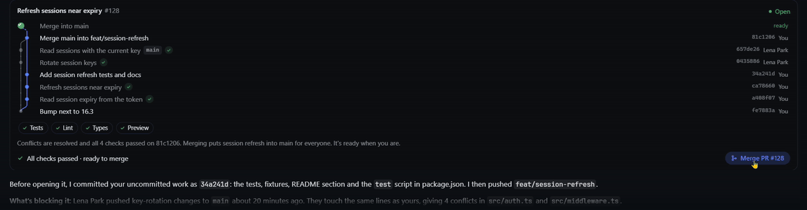
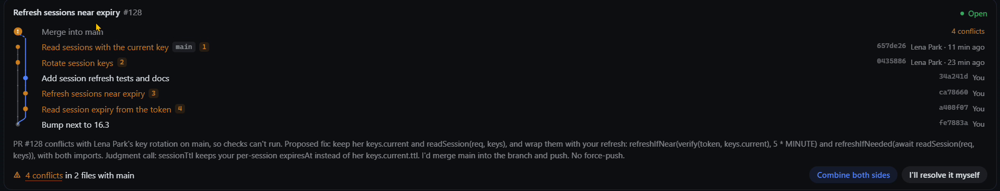
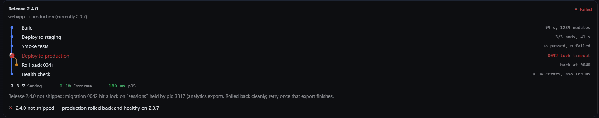
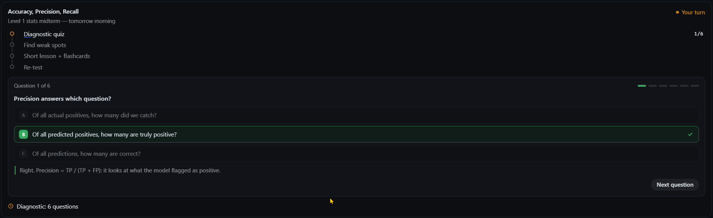

# GenUI for Hermes

Why is the only way to work with an agent still text? This plugin for [Hermes Agent](https://github.com/NousResearch/hermes-agent)
gives the agent **living components**: it shows a pre-designed card when a task starts, updates it in
place after every tool result while it works, and asks for a decision with a button only when one is
needed. What you choose in the card goes straight back to the agent.









The plugin itself, as submitted to the Hermes plugin catalog
([NousResearch/hermes-agent#152159](https://github.com/NousResearch/hermes-agent/pull/152159)), is
[`plugin/`](plugin/README.md). Built for the Nous Research Hermes Agent Plugin Hackathon.

## How it works

1. The agent calls `show_component(id, type, props)` with a type from the library. Props are validated
   against the type's JSON Schema; invalid props come back to the model as errors to fix.
2. The tool returns a `::genui{id="…"}` line that the agent writes in its reply: Hermes Desktop renders
   the card there, in a sandboxed frame, with the host's colours and fonts.
3. After each tool result, the agent calls `update_component(id, patch)` (an RFC 7386 JSON Merge Patch).
   The card repaints in place: no rebuild, no flicker, no scroll jump.
4. Before a risky or irreversible step, the agent adds an action to the card, explains why, and ends
   its turn. A click sends one user turn back:
   `{"type":"user_action","component_id":"rel","action_id":"deploy_prod","values":{...}}`, where `values`
   holds what the user chose in the card (for example the ticked items).

The turn hint in [`plugin/prompt.py`](plugin/prompt.py) carries the rules: show the card early, update
it after every result, never show a state no tool has confirmed, one card per entity, ask before risky
steps only, act on exactly what the user chose, show failures with their real cause.

### Components

| Type | For | Decision it can carry |
|---|---|---|
| `pr_card` | a pull request: commits, conflicts, checks, merge | resolve conflicts, merge |
| `task_card` | a long operation: a release, a migration, a machine to diagnose | deploy to production, roll back, stop a process |
| `review_list` | items to review before an irreversible action: files, branches | delete exactly what the user ticked |
| `study_card` | a study session: a quiz answered in the card, mastery per topic, a lesson, reviews | send the answers, set review reminders |

### Tools

- `show_component(id, type, props)` → `{"ok": true, "directive": "::genui{id=\"…\"}"}` or `{"ok": false, "errors": [...]}`
- `update_component(id, patch)` → `{"ok": true}` or `{"ok": false, "errors": [...]}`; an invalid patch changes nothing
- `ask_user(question)`: a plain-text question when no card helps; the answer is the user's next message

## Install

The plugin has two halves: the agent half runs where Hermes runs (the tools, the turn hint, the
backend route the card loads from), the desktop half runs in Hermes Desktop (the card renderer).

Once the catalog entry is merged, `hermes plugins install genui` then `hermes plugins enable genui`
does it (see [`plugin/README.md`](plugin/README.md#install)). Until then, or to work on the plugin:

**Agent half**, on the Hermes host: copy `plugin/` to `~/.hermes/plugins/genui/`, then

```sh
hermes plugins enable genui
```

It needs `jsonschema` in Hermes' Python environment (declared in `plugin/plugin.yaml`; Hermes ships
it only with its `mcp` extra).

or, from this repo, deploy over SSH (`HERMES_HOST` in `.env` is an SSH alias with key auth):

```sh
python scripts/deploy.py --enable --restart
```

**Desktop half**: link or copy `plugin/desktop/` to Hermes Desktop's plugin folder as `genui`
(on Windows `%LOCALAPPDATA%\hermes\desktop-plugins\genui`), then restart Hermes Desktop. The `genui`
chip in the status bar checks that the desktop half reaches the backend.

The turn hint is sent on the Desktop platform only: try it in Hermes Desktop, not `hermes chat`.

## Themes

A theme only draws props. Each agent (Hermes profile) picks its themes in its `config.yaml`; a theme
without a file for a component falls back to `default`:

```yaml
plugins:
  entries:
    genui:
      settings:
        theme: default
        overrides: {pr_card: acme}
```

To add a theme, write `plugin/themes/<theme>/<type>.js`:

```js
GenUI.register("pr_card", (root, props, emit) => {
  // Draw props into root. The same root comes back on every update: change what differs.
  // Buttons carry data-action="<id>" and call emit(id); inputs marked data-field="<name>"
  // are sent with the click as values.
});
```

`GenUI.motion` (`plugin/motion.js`) animates those changes: `keyed` lists whose new rows grow in and
old ones fold away, `decode` and `roll` for text, `toggle` for sections, `popover` for hover details.
`demo/cards/` replays one scripted task per use case (pull request, release, slow machine, cleanup) through
the real Desktop half, runtime and theme: serve
the repo root (`python -m http.server 8765`) and open `http://localhost:8765/demo/cards/`.

To add a component, add `plugin/components/<type>/schema.json`, its `default` theme, and a copy of the
schema in `benchmark/library/` (a test checks they match).

## Tests

```sh
python -m venv .venv
.venv/Scripts/activate            # Windows; `source .venv/bin/activate` on Linux/macOS
pip install -r requirements.txt
playwright install chromium
python -m pytest tests
```

The suite covers schema validation, merge patches and the per-chat store; the plugin as Hermes loads
it; the Desktop half in a browser (show, three updates, a click, a selection reaching the model as
`values`); the benchmark's validity; the benchmark adapter.

## Benchmark

[`benchmark/`](benchmark/README.md) holds 11 tasks in four families (pull request, release and machine,
review before deleting, negative controls), graded on the trace: right card or none, early and live
updates, no unverified state, consent enforced by a scripted world, decisions cleared once answered,
and what the agent did with the user's choice.

```sh
python benchmark/run_eval.py --agent reference       # the reference policies: 100 %
python benchmark/run_eval.py --agent silent          # works with no UI and never asks: 0 %
```

## Known limits

- The card appears where the model writes the `::genui` line. Models tend to write it with their
  reply, so the card often arrives after the first long step rather than before it.
- A click shows up in the chat as a user message holding the JSON event: plugins cannot send hidden turns.
- `ask_user` cannot wait for the answer (Hermes' own `clarify` tool is not reachable from a plugin):
  the agent asks in its reply and ends its turn.

## Layout

```
plugin/              the Hermes plugin (agent half, backend route, desktop half, components, themes)
benchmark/           benchmark v3: tasks, scripted worlds, graders, reference agents, model adapter
tests/               pytest suite (unit, plugin, browser, benchmark validity)
demo/cards/          motion study: one scripted task per use case, replayed through the real cards
scripts/deploy.py    deploy the agent half to a Hermes host over SSH
docs/                images for this README
```

## License

MIT, see [LICENSE](LICENSE).
