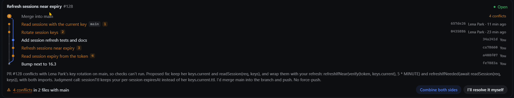
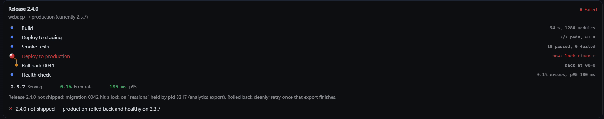
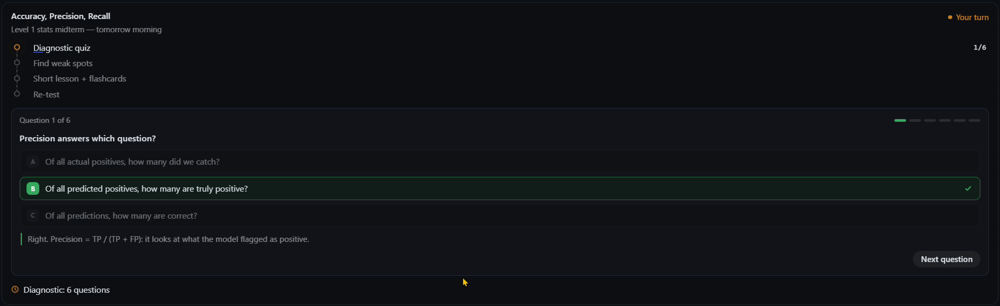

# GenUI: live cards for Hermes Agent

Hermes works in text: long tasks scroll by as tool calls, and every decision is a reply you type.
GenUI gives the agent **live components**. It shows a card when a task starts, updates it in place
after every tool result, and asks for a decision with a button only when one is needed. What you
pick in the card goes straight back to the agent.



## The cards

| Card | For | The decision it carries |
|---|---|---|
| `pr_card` | a pull request: commits on a real branch graph, conflicts with who changed what, checks, merge | resolve conflicts, merge |
| `task_card` | a long operation: a release, a migration, a slow machine; its steps, live figures, findings | deploy, roll back, stop a process |
| `review_list` | items to review before an irreversible action: files to delete, branches to prune | act on exactly what you ticked |
| `study_card` | a study session: a quiz you answer in the card, mastery per topic, a lesson with flashcards, reviews | send your answers, set review reminders |





Every change a card shows is shown as motion: rows grow in and text decodes into place, the busy
line shimmers, a clicked button turns into its own busy state, figures count to their new values,
and on success the colour runs down the card. Cards follow your Hermes Desktop theme (light, dark or
your own) and stay compact.

## How it works

1. The agent calls `show_component(id, type, props)`. Props are validated against the type's JSON
   Schema; invalid props come back to the model as errors to fix.
2. The tool returns a `::genui{id="…"}` line the agent writes in its reply. Hermes Desktop draws the
   card there, in a sandboxed frame, with your theme's colours and fonts.
3. After each tool result the agent calls `update_component(id, patch)`, a JSON Merge Patch (RFC 7386).
   The card repaints in place.
4. Before a risky or irreversible step the agent adds an action to the card and ends its turn. Your
   click comes back as one turn: `{"type":"user_action","component_id":"rel","action_id":"deploy_prod","values":{…}}`,
   where `values` holds what you chose in the card (ticked items, quiz answers).

A short turn hint (sent on the Desktop platform only) tells the agent the rules: show the card early,
update it after every result, never show a state no tool confirmed, one card per entity, ask only
before risky steps, act on exactly what you chose, and report failures with their real cause.

Tools: `show_component`, `update_component`, and `ask_user` for a plain question when no card helps.

## Install

```sh
hermes plugins install genui
hermes plugins enable genui
```

The plugin has two halves: the agent half runs where Hermes runs (the tools, the turn hint, the
route the cards load from), the Desktop half runs in Hermes Desktop (the card renderer). If your
Desktop connects to a remote gateway, install the plugin on that host and in Desktop.

Requires Hermes 0.22.5 or later, and `jsonschema` (declared in `plugin.yaml`, installed with the plugin). Cards render in Hermes Desktop; on other platforms the agent works in
text as usual (the hint is not sent there).

## Themes

A theme only draws props. Each Hermes profile picks its theme in `config.yaml`; a theme with no file for
a component falls back to `default`:

```yaml
plugins:
  entries:
    genui:
      settings:
        theme: default
        overrides: {pr_card: acme}
```

A theme is `themes/<name>/<type>.js` calling `GenUI.register(type, (root, props, emit) => …)`, with
`GenUI.motion` for the moves (keyed lists that grow and fold, decoding text, counting figures,
popovers). The default theme shares its parts across cards in `themes/default/kit.js`.

## What it does on your machine

- **No network calls, no third-party service, no telemetry.** Cards load from the plugin's own route on
  your Hermes host.
- **Writes** one small JSON file per shown card (its props and revision) in the plugin's data
  directory, so a card survives a reload. Cards nobody updated for 30 days are removed when a new
  card is shown. It reads nothing outside its own files and holds no credentials.
- **Adds a turn hint** of a few hundred tokens to each Hermes Desktop turn, so the agent knows the
  cards exist.
- **Runs no commands and no background processes.** The agent's own tools do the work; the cards
  only show it.
- **Desktop half:** each card runs in a sandboxed frame (opaque origin, scripts only) and draws the
  agent's data as text. A click on a decision sends one visible message from you to the chat; a click
  on a link in a card opens it in your browser.

## Limits

- The agent decides when to show a card: a task that matches no card stays in text.
- A click shows up in the chat as a JSON message from you: the Desktop SDK has no hidden way to send
  it.

The repository also holds a benchmark that measures the plugin against plain Hermes on scripted
tasks (natural requests, a scripted world as the only truth, consent enforced by the world, negative
controls).

## License

MIT, see [LICENSE](LICENSE).
